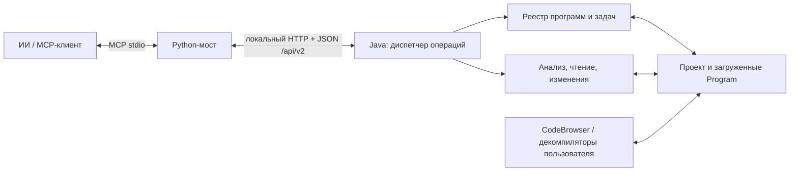

# MCP-мост для Ghidra 12.2

Статус: архитектура и контракт реализованного MCP v2. Дата: 2026-10-26.
Точные схемы 92 инструментов: [`protocol/tools.json`](../protocol/tools.json).
Ветка: `feature/ghidra-12.2-multiprogram`.

## 1. Основной сценарий

У ИИ одна точка входа — MCP. Ghidra запущена, а MCP самостоятельно находит файлы
проекта, загружает программы в память, анализирует, декомпилирует, изменяет и
сохраняет их. Окна CodeBrowser и декомпилятора для этих операций не требуются.
Пользователь может открыть ту же программу в GUI и наблюдать результат; это тот
же объект `Program`, с тем же `program_id` и несохранёнными изменениями.

Поддерживаются несколько одновременно загруженных программ, несколько
CodeBrowser и несколько представлений одной программы. Переключение активной
вкладки не меняет адресата уже отправленного запроса.

В этом этапе нужен один процесс Ghidra и один активный проект. Отдельный полностью
headless launcher остаётся возможным расширением общего ядра с тем же MCP API.
Он не нужен для фоновой работы и не является вторым интерфейсом для ИИ.
Подключение обычного GUI к уже запущенной headless JVM не обещается.

## 2. Устройство моста



- Python описывает типизированные MCP-инструменты, асинхронно вызывает Java,
  передаёт отмену и переводит результаты в MCP. Выбранной программы в Python нет.
- Java проверяет параметры, права записи и состояние программы, удерживает
  `Program`, выполняет операции, транзакции и задачи.
- Сервер живёт в плагине уровня приложения — Project Window, а не конкретного
  CodeBrowser. Он доступен и при нуле открытых CodeBrowser.
- Все работающие CodeBrowser обнаруживаются через `ToolManager`. Установка
  дополнительного MCP-плагина в каждое окно не требуется.
- GUI-адаптер отвечает за показ программы и навигацию. Основные операции не
  используют `getCurrentProgram()`.
- Один HTTP-сервер слушает loopback на процесс Ghidra. Закрытие CodeBrowser не
  останавливает его. Закрытие проекта освобождает его программы, но сервер остаётся
  доступен для открытия другого проекта.

Для Ghidra 12.2 проверен механизм плагина `ApplicationLevelOnlyPlugin`:
`FrontEndTool` поддерживает такие плагины и события открытия/закрытия проекта.
На чистом профиле RELEASED-плагин обнаруживается автоматически; в существующем
профиле он включается в Project Window → File → Configure.
Однократное включение расширения относится к установке; при работе ИИ открывать
CodeBrowser для запуска сервера не требуется.

`close_project` требует завершить активные операции, освободить все фоновые
программы и закрыть все инструменты проекта, включая пустые CodeBrowser.
Проверяются также `Project.getOpenData()` и прочие инструменты Ghidra; оставшиеся
владельцы дают `PROJECT_IN_USE`. Автоматического сохранения программ нет.
`open_project` не восстанавливает сохранённые окна инструментов и создаёт пустое
workspace, если его нет.

`ProjectLifecycle` в 12.2 передаёт штатным плагинам `projectClosed` перед сбросом
активного проекта: одного `setActiveProject(null)` для этого недостаточно.
Список слушателей доступен только через внутренний метод `FrontEndTool.getListeners`;
адаптер проверяет точную версию и доступность метода до закрытия проекта,
иначе возвращает `UNSUPPORTED_CAPABILITY`.

## 3. Сущности и время жизни

| Поле | Что обозначает | Срок действия |
|---|---|---|
| `server_id` | Конкретный запущенный Java-сервис | До перезапуска сервиса |
| `project_id` | Открытая сессия проекта | До закрытия проекта |
| `program_id` | Загруженный объект `Program` | До его логического закрытия |
| `project_path` | Путь файла внутри конкретного проекта | До перемещения/переименования файла |
| `tool_id` | Окно CodeBrowser | До закрытия окна |
| `job_id` | Длительная операция и её результат | До истечения опубликованного срока хранения |
| `revision` | Наблюдаемое состояние конкретной программы | До изменения программы |

ID непрозрачны. Имя файла, адрес, хеш бинарника и заголовок окна не заменяют ID.
Одинаковый `Program` в двух CodeBrowser получает один `program_id`; два разных
файла с одинаковым именем получают разные ID. При закрытии и повторной загрузке
создаётся новый `program_id`.

Файлы проекта и загруженные программы различаются:

```text
list_project_files(project_id)        -> файлы, включая ещё не загруженные
open_program(project_id, project_path)-> program_id, без открытия окна
list_programs(project_id)             -> живые программы, включая фоновые
show_program(program_id)              -> показать тот же Program пользователю
```

`open_program` идемпотентен в пределах живой программы: повторное открытие того же
файла использует уже загруженный объект и устанавливает удержание со стороны MCP.
По умолчанию `analysis="none"`: загрузка не запускает анализ. Режим
`analysis="if_needed"` при открытии/импорте разрешает первоначальный автоанализ
без GUI-диалогов; его правила описаны в разделе 5. Обновление формата и сохранение
остаются отдельными решениями. Если программе требуется обновление формата, возвращается
`UPGRADE_REQUIRED`; повторный вызов с `allow_upgrade=true` разрешает его в памяти.
Сохранение обновлённой программы остаётся отдельной операцией.

В `get_program_info` возвращаются `mcp_owned` и `open_in_tool_ids`. У программ,
открытых только пользователем, нет постоянного удержания со стороны MCP.
Каждый выполняющийся запрос дополнительно удерживает программу отдельным consumer
и освобождает его в `finally`.

Принятая операция записи также закрепляет программу за MCP до явного
`close_program`. Это не даёт потерять несохранённый результат, если пользователь
закрыл последнее окно во время записи. Новое владение отражается в метаданных.

`close_program` снимает удержание MCP. Если программа остаётся в GUI, её ID
остаётся рабочим; ответ содержит `closed=false` и `open_in_tool_ids`. Для закрытия
вкладки предусмотрен отдельный `close_program_in_tool`.
Когда не остаётся ни MCP-, ни GUI-владельцев, ID закрывается для новых запросов.
Уже принятые запросы завершаются с удержанным объектом; физическое освобождение
происходит после них. ID не переназначается другой программе.

Явное закрытие последнего владельца при незавершённой записи/анализе возвращает
`PROGRAM_BUSY`: сначала нужно дождаться задачи или отменить её и получить итог.

Закрытие последнего владельца несохранённой программы возвращает
`UNSAVED_CHANGES`. Сначала вызывается `save_program`, либо явно передаётся
`discard_changes=true`. Автоматического сохранения и диалога, ожидающего человека,
в MCP-операциях нет. Отказ от изменений относится только к окончательно
освобождаемой программе и не откатывает состояние программы, остающейся в GUI.

## 4. Общий контракт

Все инструменты работы с программой требуют `program_id`. Для операций над
проектом обязателен `project_id`, кроме первоначального открытия/создания.
У инструментов GUI требуется `tool_id`, кроме явно описанного создания окна.
Системные запросы `get_server_info` и `list_projects` не требуют ID программы.

### Адреса и ссылки

- Адреса передаются строками. Ввод `0x100389` означает адрес в пространстве
  программы по умолчанию; ответ содержит каноническое `ram:0x100389`.
  Overlay-пространство сохраняется в строке адреса.
- Адрес не является file offset или адресом процесса во время исполнения.
  `file_offset` также строка с hex-смещением. Перевод выполняют отдельные инструменты.
- Функцию адресуют по `function_address` — адресу входа. Получить её по адресу
  внутри тела позволяет `get_function(..., match="containing")`.
- Имена предназначены для поиска. Одинаковое имя не разрешается произвольно в
  первую найденную функцию.
- Тип адресуется полным `type_path`, например `/Crypto/MutexState`, а не коротким
  именем без категории.
- Локальные переменные адресуются `variable_id`, полученным из
  `list_variables`; он связан с функцией, ревизией программы и fingerprint
  результата декомпиляции, включая её настройки. Сервер сохраняет описание
  символа/storage/first-use и проверяет его при записи; порядковый индекс или
  object identity не являются ID. Неоднозначное повторное сопоставление даёт
  `STALE_VARIABLE`, а не переименовывает другую переменную с тем же именем.
- Диапазоны памяти задаются как `address + length` либо `[start, end)`:
  `end` не включён. Диапазоны Ghidra с включённым концом нормализуются при выдаче.
  Размеры инструкций, полей и смещения полей считаются в байтах; bitfield metadata
  отдельно содержит смещение и размер в битах.

### Результаты

Успешный программный запрос имеет общее обрамление и типизированное `data`:

```json
{
  "request_id": "req-...",
  "server_id": "srv-...",
  "program_id": "prg-...",
  "revision": "rev-...",
  "data": {
    "address": "ram:0x100389",
    "requested_length": 4,
    "returned_length": 4,
    "bytes_hex": "554889e5"
  },
  "truncated": false,
  "warnings": []
}
```

Проектные и GUI-ответы содержат соответствующие ID. Ответ об изменении дополнительно
возвращает `revision_before`, `revision_after` и `changed`. Успех записи означает
изменение в памяти; результат `save_program` отдельно подтверждает сохранение.

Списки имеют `data.items`, `data.next_cursor` и `data.has_more`. Сортировка
документирована для каждого списка: функции — пространство/адрес входа, файлы и
типы — полный путь, ссылки — адрес источника/назначения/тип/номер операнда.
`limit` по умолчанию 100, максимум 1000.
Курсор привязан к цели, фильтрам, сортировке и ревизии. При изменении данных
возвращается `CURSOR_STALE`. `truncated` относится к ограничению объёма результата,
а `has_more` — к обычному продолжению списка; это разные состояния.

Для длинного текста декомпиляции сохраняется ограниченный по времени результат:
ответ содержит `result_id`, `text`, `next_offset`, `total_length` и
`truncated`. `get_result_chunk(result_id, offset, length)` дочитывает тот же
результат без повторной декомпиляции. Полная сигнатура —
`get_result_chunk(program_id, result_id, offset, length)`; принадлежность программе
проверяется. `offset`, `length`, `next_offset` и `total_length` для текста считаются
в Unicode code points. После изменения программы возвращается `RESULT_STALE`,
после закрытия — `PROGRAM_CLOSED`, после истечения хранения — `RESULT_EXPIRED`.
`truncated` находится в общем обрамлении ответа и означает, что текст выдан
не полностью; `next_offset` позволяет продолжить именно этот результат.
Срок хранения и максимальный размер объявляет `get_server_info`.

### Ошибки

Ошибки выполнения возвращаются как MCP `CallToolResult` с `isError=true`.
Структурированный результат и текстовый JSON для клиентов без поддержки
`structuredContent` содержат одинаковые данные:

```json
{
  "request_id": "req-...",
  "server_id": "srv-...",
  "program_id": "prg-...",
  "error": {
    "code": "PROGRAM_CLOSED",
    "message": "The selected program is closed.",
    "retryable": false,
    "details": {"program_id": "prg-..."}
  }
}
```

Коды: `INVALID_ARGUMENT`, `PROGRAM_NOT_FOUND`, `PROGRAM_CLOSED`,
`PROJECT_NOT_FOUND`, `PROJECT_LOCKED`, `PROJECT_ALREADY_OPEN`, `PROJECT_IN_USE`,
`FILE_NOT_FOUND`, `UPGRADE_REQUIRED`, `ADDRESS_INVALID`, `MEMORY_UNAVAILABLE`,
`FUNCTION_NOT_FOUND`, `AMBIGUOUS_SYMBOL`, `TYPE_NOT_FOUND`, `STALE_VARIABLE`,
`READ_ONLY`, `UNSAVED_CHANGES`, `REVISION_CONFLICT`, `PROGRAM_CHANGED`,
`PROGRAM_BUSY`, `CURSOR_STALE`, `RESULT_STALE`, `RESULT_EXPIRED`, `GUI_UNAVAILABLE`,
`UNSUPPORTED_CAPABILITY`, `TIMEOUT`, `CANCELLED`, `REQUEST_ID_CONFLICT`,
`REQUEST_NOT_FOUND`, `JOB_EXPIRED`, `QUEUE_FULL`, `API_VERSION_MISMATCH`,
`BACKEND_UNAVAILABLE`, `INTERNAL_ERROR`.

После перезапуска сервиса старые ID возвращают `PROGRAM_NOT_FOUND`; отличать
закрытый ID от произвольного позволяет ограниченный реестр закрытых ID текущего
сервиса. Ошибки не маскируются строкой `Error ...` внутри успешного результата.

## 5. Каталог инструментов

В таблицах `P` обозначает обязательный `program_id`, `J` — обязательный
`project_id`, `T` — обязательный `tool_id`. Это сокращение только документации:
в MCP-схемах используются полные имена полей. `page` означает `cursor?`, `limit=100`.
Все программные изменения принимают необязательный `expected_revision`.
Длительность обычной операции ограничивает `timeout_ms`, с пределами из
`get_server_info`.

### Сервер, проект и загрузка

| Инструмент | Результат и смысл |
|---|---|
| `get_server_info()` | Версии API/Ghidra/плагина, `server_id`, `read_only`, capabilities, лимиты, состояние проекта |
| `list_projects()` | Текущий открытый проект; в этом этапе список содержит 0 или 1 элемент |
| `get_project_info(J)` | Имя, locator, доступность записи и сведения о загруженных программах |
| `create_project(directory, name)` | Создаёт новый проект и возвращает `project_id`; существующий никогда не заменяет |
| `open_project(directory, name)` | Открывает существующий проект; тот же проект возвращает прежний ID; другой активный проект даёт `PROJECT_ALREADY_OPEN` |
| `close_project(J)` | Закрывает проект после освобождения всех программ и закрытия всех инструментов, включая пустые окна; занятый проект даёт `PROJECT_IN_USE`, без скрытого сохранения программ |
| `list_project_files(J, path="/", recursive=false, query?, page)` | Файлы/папки, тип содержимого, полный путь, размер/версия при доступности, связанный `program_id`, если загружен |
| `create_project_folder(J, path)` | Создаёт папку; возвращает её полный путь |
| `get_import_options(source_path, loader?, language_id?, compiler_spec_id?)` | Подходящие loaders, языки, compiler specs и схемы их параметров для выбранной спецификации |
| `import_program(J, source_path, destination_path, loader?, language_id?, compiler_spec_id?, options?, analysis="none")` | Запускает импорт как задачу; результат — файл проекта, `program_id` и состояние подготовки; автоанализ разрешается через `analysis="if_needed"`; без перезаписи существующего файла |
| `list_programs(J?, page)` | Все живые программы, фоновые и открытые в GUI; без дублей по окнам |
| `open_program(J, project_path, allow_upgrade=false, analysis="none")` | Загружает программу в фоне или удерживает уже загруженную; возвращает `program_id` и, при `analysis="if_needed"`, состояние/задачу подготовки |
| `get_program_info(P)` | Метаданные, состояние анализа, ревизия и владельцы |
| `save_program(P)` | Сохраняет конкретную программу и подтверждает сохранённую ревизию |
| `close_program(P, discard_changes=false)` | Снимает удержание MCP; сообщает, осталась ли программа открыта в GUI |

Метаданные программы: имя и путь, `project_id`, архитектура/`language_id`,
`compiler_spec_id`, endian, размер указателя, `image_base`, executable path/format,
MD5/SHA-256 исходного бинарника при наличии, `dirty`, `read_only`, `revision`,
`mcp_owned`, `open_in_tool_ids` и признак предыдущего анализа из Ghidra.
Текущие задачи и история анализа доступны через `get_analysis_status`.
Отсутствующий хеш — `null`, а не вычисленный хеш
изменённого образа, выданный за исходный бинарник.

`import_program` создаёт новый файл проекта — это явная запись, требующая
разрешения записи. Последующие изменения программы сохраняются через
`save_program`. Без явных параметров используется предпочитаемая спецификация
штатного загрузчика Ghidra. Для выбора другой спецификации служат
`get_import_options` и параметры `loader`, `language_id`, `compiler_spec_id`;
неподходящая спецификация возвращает ошибку без GUI-диалога.
Импорт и загрузка не выполняются как скрытый эффект чтения.

### Функции, символы и декомпиляция

| Инструмент | Результат |
|---|---|
| `list_functions(P, query?, namespace?, page)` | Адреса входов, имена, размеры/диапазоны, thunk/external flags |
| `get_function(P, address, match="containing")` | Функция и её границы, сигнатура, calling convention; `match="entry"` требует точного входа |
| `decompile_function(P, function_address, timeout_ms=60000)` | C-текст, адрес функции, предупреждения декомпилятора, ревизия и продолжение длинного результата |
| `disassemble_function(P, function_address, page)` | Инструкции всех диапазонов тела функции, включая несмежные |
| `list_variables(P, function_address, source="decompiler", page)` | `variable_id`, имя, тип, размер, storage, parameter/local, ревизия |
| `list_symbols(P, query?, namespace?, kind?, page)` | Labels, функции и другие символы с однозначными адресами/пространствами имён |
| `list_namespaces(P, query?, kind="all", page)` | Пространства имён и классы; `kind="class"` заменяет отдельный список классов |
| `list_imports(P, query?, page)` | External library/symbol, локальные адреса ссылок/PLT/thunk при наличии |
| `list_exports(P, query?, page)` | Экспортированные символы и адреса |
| `list_strings(P, query?, encoding?, page)` | Определённые строки с адресом, длиной и кодировкой |
| `list_data_items(P, query?, page)` | Определённые данные, типы и ограниченное представление значения |
| `search_memory(P, pattern, mask?, start?, end?, page)` | Совпадения последовательности байтов; границы и чтение памяти остаются ограниченными |
| `get_result_chunk(P, result_id, offset, length)` | Продолжение ранее полученного большого текста/результата |

### Память, ссылки и межбиблиотечный анализ

| Инструмент | Результат |
|---|---|
| `read_memory(P, address, length, allow_partial=false)` | Байты в hex; максимум 64 KiB за запрос; длины и недоступные диапазоны |
| `disassemble_range(P, address, byte_length, start_mode="exact", decode_undefined=false, page)` | Инструкции, байты, операнды, тип перехода, `defined/pseudo`, фактическое начало |
| `list_memory_regions(P, page)` | Блоки, диапазоны, R/W/X, initialization, overlay и источники байтов |
| `address_to_file_offset(P, address)` | Все известные mappings или статус `unbacked/unknown` |
| `file_offset_to_address(P, source_file_id, file_offset)` | Все соответствующие адреса с пространствами |
| `get_xrefs(P, address, direction, kinds?, page)` | Адрес источника/назначения, вид ссылки, номер операнда, функция-источник |
| `list_callers(P, function_address, scope_program_ids?, page)` | Вызывающие функции и адреса инструкций вызова, основание разрешения |
| `list_callees(P, function_address, scope_program_ids?, page)` | Callsites, исходные/разрешённые цели и неразрешённые косвенные вызовы |
| `resolve_call_target(P, callsite_address, scope_program_ids?, max_depth=16)` | Цепочка direct/thunk/PLT/external, кандидаты, статус и доказательства |
| `resolve_import(P, external_library, symbol, scope_program_ids?)` | Возможные реализации импорта среди загруженных программ |
| `set_import_library(P, external_address, external_library)` | Назначает external location именованную зависимость, создавая библиотеку при необходимости; зарезервированное имя `<EXTERNAL>` не принимается |
| `set_external_library_path(P, external_library, J, project_path)` | Явно связывает внешнюю библиотеку с файлом проекта; операция записи |
| `get_function_cfg(P, function_address, page)` | Блоки с устойчивыми в ревизии ID, диапазоны, исходящие рёбра и неизвестные цели |
| `get_pcode(P, function_address, level="raw", page)` | P-code операции, instruction address/sequence, opcode, varnodes, block ID; `level="high"` использует декомпилятор |

Семантика, влияющая на правильность исследования:

- `read_memory` при дыре/неинициализированном диапазоне по умолчанию завершается
  ошибкой. С `allow_partial=true` возвращает адресованные chunks и gaps, а не
  склеивает байты по разные стороны дыры.
- `disassemble_range` не создаёт инструкции. `start_mode="containing"` может
  начать с начала уже определённой инструкции, содержащей адрес; точный режим
  требует границу инструкции. Псевдодекодирование явно помечается. Неопределённые
  и недоступные участки возвращаются как gaps, а не теряются.
- Перевод file offset учитывает `FileBytes` и происхождение байтов. Возможны
  несколько адресов, overlay, BSS и отсутствие сохранённого исходного файла.
  `image_base + offset` не используется как универсальное правило.
- Callers/callees возвращают каждый callsite. Область поиска по умолчанию —
  текущая программа; `scope_program_ids` явно расширяет её. Все цели и источники
  содержат собственные `program_id`. `analysis_scope="static_references"`
  указывает, что отсутствие ссылки не доказывает отсутствие вызова во время исполнения.
- Межбиблиотечное разрешение имеет статусы `resolved`, `ambiguous`, `unresolved`,
  `cycle` и `depth_limit`. Совпадение имени символа даёт кандидата. `resolved`
  требует явной связи или другой проверяемой информации, которая возвращается
  как `evidence`. Runtime interposition/IFUNC и неизвестные indirect targets
  не выдаются за доказанное статическое разрешение.
- Разрешение ничего не импортирует, не загружает и не переназначает молча.
  Незагруженные связанные файлы указываются как кандидаты для `open_program`.
- CFG возвращает исходящие рёбра вместе с блоком, поэтому пагинация не отрывает
  рёбра от источников. P-code различает address spaces, constants и temporary
  varnodes; все offsets остаются строками, а raw и high P-code явно разделены.

### Изменения программы и типов

В каждом из следующих инструментов обязателен `P`. Для короткой команды записи
требуется отдельная транзакция, которой MCP владеет исключительно; ошибка или
отмена до commit откатывает её полностью. Условие изоляции от GUI-транзакций
описано в разделе 6 и является обязательным барьером перед переносом записей.

| Инструменты | Основные параметры сверх `P` |
|---|---|
| `rename_function`, `set_function_prototype` | `function_address`, соответственно `new_name` или `prototype` |
| `rename_variable`, `set_local_variable_type` | `function_address`, `variable_id`, соответственно `new_name` или `type_path` |
| `create_function`, `delete_function` | `address`, для создания `name?` |
| `define_code` | `address`, `length`; это явное создание инструкций |
| `create_label`, `rename_label`, `remove_label` | `address`, `namespace`, имя/старое и новое имя |
| `rename_data` | `address`, `new_name`; переименование primary data label, с проверкой его существования |
| `set_comment` | `address`, `comment_type`, `text`; пустой текст удаляет комментарий |
| `get_comments` | `address`, `comment_type?`; операция чтения, без транзакции записи |
| `set_bookmark`, `list_bookmarks` | Для записи `address`, `type`, `category`, `note`; для чтения фильтры и `page` |
| `assemble_instruction` | `address`, `instruction`; только сборка в байты, без применения |
| `patch_bytes` | `address`, `bytes_hex`, `expected_bytes_hex?` |
| `list_data_types`, `get_type` | Для списка `category?`, `query?`, `page`; для получения полный `type_path` |
| `create_struct`, `create_union`, `create_enum`, `create_typedef` | Полный `type_path`; для enum `size`; для typedef `base_type_path` |
| `create_pointer` | `base_type_path`, необязательный `size` от 1 до 8 байт; без размера используется размер указателя архитектуры |
| `add_struct_field`, `edit_struct_field`, `delete_struct_field` | `type_path`, точный `field_offset` или ordinal для bitfields, параметры поля |
| `rename_struct`, `delete_struct` | Полный `type_path`, для переименования `new_name` |
| `add_union_field` | `type_path`, `field_name`, `field_type_path` |
| `add_enum_value`, `delete_enum_value` | `type_path`, `value_name`, для добавления `value` |
| `apply_data_type`, `create_array` | `address`, `type_path`; `count` для массива; конфликт с существующими данными требует явного `clear_existing=true` |
| `clear_data` | `address`, `length`; очищает определения данных, не байты и не инструкции |

`assemble_instruction(P, address, instruction)` только возвращает байты;
применение делает `patch_bytes`. Это позволяет точно описать аннотацию чтения
и запрет записи для каждого инструмента.
`list_*`, `get_*` из этой таблицы также остаются чтением.

Точное определение битовых полей и прототипов берётся из Ghidra; неподдерживаемый
вариант возвращает структурированную ошибку, без частичной правки. Изменение
прототипа не должно предварительно сохранять комментарий в отдельной транзакции.

### Анализ и длительные задачи

| Инструмент | Результат |
|---|---|
| `get_analysis_options(P)` | Доступные анализаторы с `analyzer_id`, именем, типом auto/one-shot, применимостью, текущими/default значениями и типизированными параметрами |
| `get_analysis_status(P)` | Признак анализа Ghidra, текущая работа, известный исход последнего запуска MCP, доступность истории и предупреждения |
| `start_analysis(P, mode="auto", analyzers?, options?, ranges?, timeout_ms=300000)` | `job_id`; явный анализ, без автосохранения; `mode="one_shot"` запускает явно выбранные применимые анализаторы |
| `start_analysis_batch(program_ids, options_by_program?, timeout_ms=300000)` | Родительский job и отдельные дочерние задачи по программам; ограниченный параллелизм, отдельные исходы, без общей транзакции |
| `get_analysis_log(P, job_id?, page)` | Сохранённый журнал запуска MCP за доступный период; отсутствие истории отмечается явно |
| `list_jobs(program_id?, status?, page)` | Снимок кратких статусов задач MCP; результат задачи читается через `get_job`. Внешний анализ виден через `get_analysis_status` |
| `get_job(job_id, wait_ms=0)` | Статус, progress, этап, целевые ID, результат/ошибка; ожидание максимум 10 секунд |
| `cancel_job(job_id)` | Запрос отмены с текущим состоянием; повторный вызов допустим |

Состояния: `queued`, `running`, `cancelling`, `succeeded`, `failed`, `cancelled`,
`timed_out`. `cancel_job` не выдаёт запрос отмены за уже завершённую отмену.
`get_job` для неудачно завершённой задачи возвращает её ошибку с `isError=true`.
Для `import_program` окончательный результат доступен через эти же инструменты.

При первом открытии Ghidra предлагает **Auto Analysis**. Он определяет код,
функции, ссылки, данные и запускает выбранные анализаторы; некоторые из них
используют декомпилятор. Это не предварительное получение C-текста всех функций.
`decompile_function` остаётся отдельной операцией чтения.

`open_program(..., analysis="if_needed")` после загрузки возвращает `program_id`
и объект `analysis` с полями `state`, `reason`, `job_id`, `history_known`.
Возможные состояния — `not_requested`, `not_needed`, `queued`, `running`,
`blocked_read_only`. Для нового запуска `job_id` ссылается на отдельную задачу
`start_analysis`, которую можно ожидать или отменять обычными инструментами.
Результат `import_program` содержит такой же объект после успешного импорта:
завершение импорта не означает завершение задачи анализа.

Правила `if_needed`:

- Если анализ уже идёт, повторно он не запускается. Возвращается существующий
  job; внешний GUI-анализ возвращается с `origin="gui"`, `job_id=null` и
  `cancellable=false`. Для него не создаётся фиктивная задача MCP.
- Если программа ещё не помечена проанализированной либо MCP знает о своём
  прерванном/неудачном первоначальном запуске, ставится задача автоанализа.
  Прерванная работа перезапускается; возобновление с точного места не обещается.
- Если есть только сохранённая метка Ghidra `analyzed`, анализ пропускается с
  `reason="marked_analyzed"`, `history_known=false`. Метка не доказывает успех
  всех анализаторов: в GUI она может устанавливаться до окончания работы.
- Выбор анализаторов и значения по умолчанию берутся у Ghidra для этой программы
  и архитектуры. Изменённые настройки, повторный полный анализ и one-shot
  запускаются явно через `start_analysis`.
- В `read_only` чистая загрузка остаётся допустимой, но подготовка возвращает
  `blocked_read_only` с причиной. Результат не обещает готовность программы;
  прямой `start_analysis` при этом даёт `READ_ONLY`.
- Анализ работает без диалога выбора опций и без скрытого сохранения.
  `show_program` не должен повторно предлагать анализ, уже выполненный MCP;
  неподтверждённая успешность не заменяется фиктивной меткой успеха.

В one-shot режиме `analyzers` обязателен; неподходящие анализаторы возвращаются
как ошибки параметров, а не игнорируются. Например, так можно отдельно запускать
доступные анализаторы параметров декомпилятора, switch и стека. Параметры
`start_analysis` применяются к настройкам программы в памяти и возвращаются как
`effective_options`; сохранение настроек вместе с программой остаётся явным.
`start_analysis_batch` принимает явный список ID, не зависит от текущих окон и
проверяет параметры отдельно для каждой архитектуры. Ошибка одного файла не
скрывает успешные результаты остальных.

`job_id` равен `request_id` исходной операции. В ответах задач всегда остаются
`job_id`, `operation`, `state`, `progress`, `effects`, затронутые ID и итоговые
ревизии, включая неуспех. `outputSchema` задаёт дискриминированный по `operation`
тип результата, а `error` описывает терминальную неудачу. Например:

```json
{
  "job_id": "req-...",
  "operation": "start_analysis",
  "state": "cancelled",
  "progress": null,
  "effects": "partial",
  "program_revisions": {"prg-...": "rev-after"},
  "error": {"code": "CANCELLED", "message": "Analysis cancelled.", "retryable": false, "details": {}}
}
```

Отмена коротких команд записи до commit откатывает транзакцию. Анализ и импорт
могут иметь отдельные этапы с уже применёнными изменениями: ответ явно содержит
`effects="none|partial|committed"`, затронутые программы/файлы и их `dirty`.
Полный rollback длительного анализа не обещается; автоматического save нет.
Сохранение — отдельная операция: после успешной записи на диск отмена не означает
откат сохранённого файла. Терминальное состояние фиксирует фактический исход.

### Дополнительные операции GUI

| Инструмент | Результат |
|---|---|
| `list_tools()` | CodeBrowser с `tool_id`, открытыми программами и текущим `program_id` |
| `get_gui_state(T)` | Программа, адрес, функция и выделение конкретного CodeBrowser |
| `show_program(P, tool_id?, new_tool=false, address?)` | Показывает тот же `Program`; возвращает `tool_id`; без указанного окна создаёт CodeBrowser при необходимости |
| `navigate_to(T, P, address)` | Явно активирует программу/позицию в указанном окне |
| `set_selection(T, P, ranges)` | Явное изменение выделения |
| `close_program_in_tool(T, P, discard_changes=false)` | Закрывает конкретную программу в конкретном CodeBrowser; остальные владельцы остаются |
| `close_tool(T, save_configuration=true)` | Сохраняет изменённую конфигурацию CodeBrowser штатным `saveTool` и закрывает окно; программы не сохраняет. `false` отклоняет закрытие окна с изменённой конфигурацией |

`tool_id` и `new_tool=true` в `show_program` взаимоисключающие. Без обоих параметров
используется существующий CodeBrowser с этой программой, иначе создаётся новый;
выбор не зависит от текущего фокуса и возвращается в результате.
GUI-инструменты исполняют короткую часть работы на EDT. Они не нужны для
декомпиляции и не вызываются основными инструментами скрыто.
Создание native frozen-clone окна декомпилятора не входит в обязательный API:
публичный factory в 12.2 не подтверждён. Новый CodeBrowser с обычным декомпилятором
поддерживается публичным API и покрывает просмотр нескольких программ.

Показ ещё не анализированной программы подавляет только первичный диалог анализа
на время сессии. `GuiService` проверяет версию 12.2 и приватное boolean-поле
`AutoAnalysisManager.alreadyAskedThisSession`; метаданные `ANALYZED` и
`ASK_TO_ANALYZE` не меняются. Несовместимый runtime даёт `UNSUPPORTED_CAPABILITY`.
В `close_tool` конфигурация проверяется через `hasConfigChanged`: `shouldSave`
у `GhidraTool` может показать диалог или вернуть true для чистого окна с autosave.
Результат `configuration_saved` относится к сохранению изменённого шаблона окна,
а сохранение программы остаётся отдельным `save_program`.

## 6. Параллельность, чтение и запись

- Python-инструменты — `async`, HTTP-клиент — асинхронный. Текущие блокирующие
  `requests.get/post` нельзя оставить внутри обработчиков MCP SDK v1.
- Пул Java workers ограничен. Разные программы обрабатываются параллельно;
  записи и анализ одной программы сериализуются. Очередь имеет предел и deadline.
- Простого `startTransaction` вместе с MCP-lock недостаточно: в Ghidra 12.2
  транзакции разных потоков могут присоединяться к общей транзакции программы.
  `TransactionGuard` удерживает monitor реального transaction manager во время
  короткой записи и проверки `expected_revision`. Это версия-зависимый адаптер
  приватного поля Ghidra 12.2: публичный API не даёт необходимой изоляции.
  Неподдерживаемый manager (включая синхронизированные транзакции нескольких
  DomainObject) возвращает `UNSUPPORTED_CAPABILITY`; активная транзакция —
  `PROGRAM_BUSY`. Проверка двумя потоками подтверждает, что откат MCP не
  отменяет параллельную правку другого потока. Сохранение проверяет ревизию
  под тем же monitor перед штатным `Program.save`.
- На каждую декомпиляцию создаётся отдельный `DecompInterface`, привязанный
  к выбранной программе; после операции экземпляр освобождается.
- Чтение не создаёт определения инструкций, не запускает анализ, не меняет
  комментарии, выделение, фокус или активную программу.
- Внутренние блокировки MCP не блокируют произвольные правки пользователя в GUI.
  Поэтому ревизия проверяется до и после чтения. Если программа изменилась,
  результат не выдаётся за согласованный снимок: возвращается `PROGRAM_CHANGED`.
  Курсор и результаты декомпиляции также привязаны к ревизии.
  Живые метаданные `get_program_info`, `get_analysis_status` и `get_analysis_log`
  доступны во время анализа и не обещают атомарный снимок содержимого программы.
- Межпрограммные операции удерживают все прочитанные программы и проверяют
  ревизии каждой. Ответ содержит `program_revisions: {program_id: revision}`;
  курсор связан со всем набором целей, ревизий и параметров. Изменение любой
  участвующей программы обнаруживается, даже если основная программа не менялась.
- `expected_revision` позволяет отклонить запись поверх изменившегося состояния.
  Проверка выполняется вместе с началом транзакции, а не заранее в Python.
- По умолчанию сервер предоставляет полный доступ; политику действий ИИ
  определяет MCP-клиент. Дополнительный `read_only=true` включается только
  владельцем сервера при необходимости и запрещает через MCP изменения программы,
  анализ, импорт, создание/изменение проекта, обновление формата и сохранение.
  Загрузка существующей программы без обновления, освобождение чистой программы
  и операции просмотра допустимы. Режим не запрещает самому пользователю править
  программу в GUI.
- `discard_changes=true` запрещён при `read_only`. Снять владельца грязной
  программы можно только если другой владелец продолжает удерживать тот же
  объект. Закрытие последнего владельца/окна с потерей изменений запрещено.
  Проверка эффектов учитывает параметры и текущее состояние, не только имя метода.
- Переход в запись не предоставляется как инструмент, обходящий `read_only`.
  Аннотации MCP описывают поведение, а Java-диспетчер обеспечивает запрет.

Аннотации: чистое чтение — `readOnlyHint=true`; изменение сессии/окон —
`readOnlyHint=false`, даже если база не меняется; запись — также false.
`destructiveHint=true` для удаления, замены определений, patch и отказа от
несохранённых изменений. `idempotentHint` назначается по фактическому поведению
операции. Каталог MCP описывает эффекты `read`, `session`, `ui`, `program_write`,
`project_write`, `save`; Java проверяет их через собственные `OperationDefinition`,
отдельно различая обычное чтение, живые статусы и длительный анализ.

## 7. Внутренний HTTP API

Python и Java согласуют `api_version=2` и capabilities при соединении.
Несовместимая версия завершается понятной ошибкой до первого программного запроса.

```http
POST /api/v2/operations/read_memory
Content-Type: application/json

{
  "request_id": "uuid-generated-by-bridge",
  "arguments": {
    "program_id": "prg-...",
    "address": "ram:0x100389",
    "length": 32
  },
  "timeout_ms": 10000,
  "wait_ms": 1000
}
```

Внутренние маршруты:

```text
GET  /api/v2/server
POST /api/v2/operations/{operation}
GET  /api/v2/requests/{request_id}?wait_ms=1000
POST /api/v2/requests/{request_id}/cancel
```

Короткая операция возвращает HTTP 200 с итогом. Принятая, но ещё выполняющаяся —
202 с `{request_id, state, operation}`. Мост сам ожидает обычные операции; наружу job отдаётся для
`start_analysis`, `start_analysis_batch` и `import_program`. Внутренний `request_id` создаётся до отправки,
поэтому запрос отмены возможен и при потере первого ответа.

Повтор одинакового request ID и payload возвращает существующую операцию.
Другой payload с тем же ID даёт `REQUEST_ID_CONFLICT`. Дедупликация действует
только внутри указанного `server_id` и опубликованного срока хранения;
гарантия exactly-once после перезапуска отсутствует. После сетевого обрыва запись
не повторяется автоматически с новым ID.

MCP-отмена инициирует короткий отдельный запрос отмены Java. Серверный deadline
действует даже при потере связи. `TaskMonitor` и декомпилятор получают отмену;
отмена ожидания HTTP сама по себе не считается отменой работы.

Cancel, пришедший раньше исходного запроса, сохраняется как cancellation tombstone
на опубликованный срок хранения; последующая регистрация такого ID завершается
`CANCELLED`. В SDK v1 отправка cancel выполняется в коротком защищённом от внешней
отмены async scope. `timeout_ms` ограничивает всё выполнение с момента приёма,
включая очередь. `wait_ms` ограничивает только ожидание HTTP-ответа. Успешное
возвращение job из `start_analysis`/`start_analysis_batch`/`import_program` не отменяет задачу; она живёт
до своего deadline или явного `cancel_job`.

HTTP-статусы: 400 — некорректные параметры/версия API, 403 — `READ_ONLY`,
404 — неизвестная цель/запрос, 409 — конфликт состояния/ревизии/ID,
410 — устаревший HTTP API, 429 — `QUEUE_FULL`, 500 — внутренняя ошибка.
Ответ всегда содержит структурированное обрамление ошибки, если запрос дошёл до
диспетчера. Polling существующей задачи возвращает HTTP 200 независимо от её
успеха: мост проверяет `state/error` и выставляет MCP `isError` по исходу операции.
Невалидный JSON или ответ старого плагина мост переводит в структурированную
ошибку backend-протокола, сохраняя ограниченные диагностические сведения.

Параметры инструментов и общее обрамление результата описаны JSON Schema
в `protocol/tools.json`; Python проверяет параметры до HTTP-вызова. При доступном
backend список MCP фильтруется по опубликованным Java операциям; протокольные
тесты проверяют схемы, аннотации и передачу ошибок. Универсального MCP `execute(command, args)` и произвольного исполнения
скриптов в этот API не добавляется: инструменты имеют собственные схемы.

## 8. Миграция существующих инструментов

Это намеренно несовместимая версия API: вызов над программой без `program_id`
не работает и не подставляет активную программу. Старые unversioned HTTP-маршруты
отключаются с сообщением о переходе на v2. Дубли инструментов объединяются,
чтобы у ИИ был один основной способ выполнить каждую операцию.

| Текущие имена | Контракт v2 |
|---|---|
| `list_methods`, `list_functions`, `search_functions_by_name` | `list_functions(P, query?, namespace?, page)` |
| `list_classes`, `list_namespaces` | `list_namespaces(P, kind, ...)` |
| `decompile_function`, `decompile_function_by_address` | `decompile_function(P, function_address, ...)`; поиск имени отдельным вызовом |
| `get_function_by_address` | `get_function(P, address, match)` |
| `rename_function`, `rename_function_by_address` | `rename_function(P, function_address, new_name)` |
| `get_current_address`, `get_current_function` | `get_gui_state(tool_id)` |
| `get_xrefs_to`, `get_xrefs_from`, `get_function_xrefs` | `get_xrefs(P, address, direction, ...)`; для именно вызовов — callers/callees |
| `list_segments` | `list_memory_regions(P, ...)` |
| `set_decompiler_comment`, `set_disassembly_comment`, `set_comment` | `set_comment(P, address, comment_type, text)`; прежние варианты соответствуют PRE/EOL |
| `get_struct`, `get_type` | `get_type(P, type_path)` |
| `rename_variable`, `set_local_variable_type` | Сохраняются с адресом функции и `variable_id` вместо неоднозначного имени |
| `assemble_instruction` | Только сборка в байты; применение через `patch_bytes` |
| Остальные операции | Сохраняются по смыслу с `program_id`, JSON-результатом, полными ссылками на типы и явными границами диапазонов |

Полезные возможности существующих 56 инструментов сохраняются. Миграция включает
обновление примеров, schema snapshot и полный список old→new; совместимость со
старыми вызовами без ID не является целью.

## 9. Этапы реализации

1. **Сборка 12.2 и контракт.** Единая версия Ghidra, JDK 25, явный compiler release,
   обновлённые CI/extension metadata, схемы и каталог эффектов. Зафиксировать
   совместимые Python-зависимости в `requirements.lock`, подключённом из requirements.
   Проверить чистую установку и настоящий MCP initialize/tools/list/tools/call.
2. **Сервис Project Window и реестр.** Запуск без CodeBrowser, обнаружение всех
   инструментов/программ, фоновые open/close, ID и удержание. Минимальный сквозной
   сценарий: list files → open → read → show same Program → close ownership.
3. **Диспетчер, ошибки и транзакции.** Один read, один write, `read_only`, ревизии,
   параллельные запросы, отмена и дедупликация запросов. Проверить на двух
   программах до массового переноса обработчиков.
4. **Перенос существующего функционала.** Все текущие операции переводятся на
   явный `Program`, структурированные результаты и общий контроль записи.
5. **Исследование нескольких библиотек.** Память, диапазоны инструкций, file
   offsets, calls/xrefs, внешние связи и разрешение целей. CFG/P-code — следующий
   подэтап этого же интерфейса, с ограничением результатов и ревизиями.
6. **Автономный рабочий цикл.** Создание/открытие проекта, import/options,
   analysis/jobs/cancel, save/reopen, явный показ в GUI и установка без ручного
   открытия CodeBrowser. Итоговый проход всех сценариев из раздела 10.

Основные Java-компоненты: application plugin/lifecycle, `ProgramRegistry`,
`ProjectService`, диспетчер `BridgeService`, `JobService`, операции исследования,
операции изменения и `GuiService`. Python разделяется на HTTP-клиент, каталог схем и
низкоуровневый MCP-сервер. Текущий монолитный плагин не становится хранилищем
состояния всех новых возможностей.

## 10. Приёмочные сценарии

- Один MCP видит девять программ, включая загруженные им без окон. Экспорты и
  декомпиляция возвращают правильную программу в каждом ответе.
- Два файла с одинаковым именем и одинаковыми адресами функций не смешиваются.
  Одна программа в двух CodeBrowser не дублируется.
- Два запроса к разным библиотекам исполняются параллельно, пока пользователь
  переключает окна. Закрытие первого CodeBrowser не выключает сервер.
- Все CodeBrowser можно закрыть; MCP продолжает работать с удержанными им
  программами и может снова показать их пользователю.
- Пользователь открывает в GUI программу, изменённую ИИ в фоне, и видит тот же
  объект, включая несохранённые изменения. У ИИ остаётся прежний `program_id`.
- Неизвестный, закрытый и устаревший после рестарта ID дают явную ошибку.
  Закрытие во время операции не освобождает используемый объект преждевременно.
- В стабильной программе чтение не меняет dirty/revision, активную вкладку,
  адрес и выделение. Конкурентная GUI-правка обнаруживается ревизией.
- `read_only` запрещает изменения и через прямой HTTP, включая анализ, импорт,
  обновление формата и save. Отклонённая команда не оставляет частичных правок.
- Отмена/timeout останавливают backend-работу; для многоэтапных операций явно
  видны уже применённые изменения. Программа не сохраняется неявно.
- Память с дырой, BSS/overlay, неоднозначные mappings, старт посередине
  инструкции, indirect calls и циклы thunk имеют проверяемые результаты.
- Символы и типы с повторяющимися именами не разрешаются по первому совпадению.
  Курсор после изменения возвращает `CURSOR_STALE`.
- Полный цикл без ручного открытия окон: создать проект → импортировать несколько
  библиотек → анализ → чтение/декомпиляция → изменение → save → close → reopen.
- Первое открытие с `analysis="if_needed"` ставит ровно один анализ, возвращает
  его статус и не показывает диалог. Повторное открытие не дублирует работу;
  известный прерванный запуск и неизвестная история анализа различаются.
- Закрытый/занятый другим процессом проект не открывается вторым writer, lock
  не удаляется. Для уже открытого GUI-проекта используется сервис его процесса.
- Чистая установка расширения/моста и обновление существующего профиля проходят
  протокольные тесты. Тест `assertTrue(true)` заменяется содержательными проверками.

## 11. Проверки и воспроизведение

Официальная Ghidra 12.2 использована с JDK 25. SHA-256 архива релиза:
`2c2cd776db3c1f6a097ba418922378ac3649cadd5e844a6f5f088ae628a7be67`.
Скрипт `scripts/download_ghidra.py` проверяет этот SHA-256. Путь к установленной
Ghidra передаётся сборке и интеграционным тестам через `--ghidra-home`.

- `tests/python/test_bridge.py`: настоящий MCP stdio, валидация схем,
  параллельность, отмена, задачи, сохранение сведений о частичных эффектах ошибок.
- `src/test/java/com/lauriewired/mcp/JobServiceTest.java` и `ResultStoreTest.java`: дедупликация запросов,
  отмена до регистрации, deadline, завершение активных задач перед освобождением
  программ, Unicode chunks и привязка результата к программе/ревизии.
- `tests/ghidra/ResearchSmoke.java`: девять библиотек с одинаковыми именами,
  параллельная декомпиляция, неизменность состояния при чтении, память, CFG,
  P-code, пагинация, привязка импорта и разрешение PLT/thunk между программами.
- `tests/ghidra/MutationSmoke.java`: изменения, типы, переменные, import binding,
  rollback и изоляция конкурирующих транзакций на настоящем runtime.
- `tests/ghidra/AnalysisSmoke.java`: первый анализ, one-shot, batch, параметры,
  отмена и сохранение, наблюдение анализа из GUI и MCP.
- `tests/python/ghidra_e2e.py`: полный путь MCP stdio → HTTP → Ghidra;
  девять программ, ошибки MCP, rename → save → close → reopen.
- `tests/ghidra/GuiSmokeRunner.java`: настоящий Project Window с плагином,
  фоновые программы и несколько CodeBrowser с теми же объектами Program.

Команды сборки, установки и проверок находятся в [`README.md`](../README.md).
`scripts/run_ghidra_tests.py` компилирует тесты против указанной установки Ghidra,
создаёт отдельную копию fixture-проекта для каждого сценария и сохраняет логи.
Рабочий проект пользователя и существующая `.venv` не изменяются.

## 12. Возможности Ghidra вне текущего MCP

Это перечень основных пробелов для автономного исследования, не полный каталог
всех расширений Ghidra. Ниже отделены реализованные возможности v2 от
дальнейших расширений.

| Возможность | Текущий MCP | Состояние проекта v2 |
|---|---|---|
| Автоанализ при первом открытии, опции, one-shot, batch, диагностика/отмена | Реализовано | Проверяется AnalysisSmoke |
| Проекты, импорт и загрузка программ без окон | Реализовано | Один активный проект на процесс |
| Память, участки инструкций, file offsets, связи библиотек | Реализовано | Неоднозначные и косвенные цели обозначаются явно |
| CFG и raw/high P-code | Реализовано | С пагинацией и привязкой к ревизии |
| Поиск числовых констант и шаблонов инструкций | Нет | Следующее расширение поиска; байтовый поиск этого не заменяет |
| Поиск ещё не определённых строк с выбором кодировки | Только список определённых строк | Следующее расширение поиска |
| Импорт C-заголовков и архивов типов `.gdt` | Только ручное создание типов | Предлагается следующим расширением типов |
| Calling convention, custom storage параметров, no-return, varargs | Частично через прототип | Требуется отдельный структурированный контракт свойств функции |
| Сигнатура конкретного callsite, split переменной, выбор поля union, commit вычисленных locals/params | Нет | Предлагается расширением операций декомпилятора |
| Forward/backward slice и цепочки def-use | Нет | Предлагается поверх P-code; P-code сам по себе не является готовым slice |
| Управляемая загрузка PDB и внешней отладочной информации | Нет отдельного API | Часть доступна через import/analyzers; отдельный контракт ещё не описан |
| Экспорт программы, типов и результатов | Нет | Требуется отдельный контракт форматов и назначения |
| Изменение карты памяти и image base | Только чтение сегментов и patch | В v2 пока только чтение карты |
| Program Diff, Version Tracking, BSim | Нет | Отдельный крупный этап |
| Эмуляция и debugger | Нет | Отдельные подсистемы, вне текущего этапа статического анализа |

Приоритет дальнейшего проектирования: поиск констант/инструкций и неизвестных
строк → импорт типов → свойства функций и callsite overrides → def-use slicing.
Это непосредственно помогает исследовать цепочки вызовов и происхождение
указателя на объект с mutex. Для каждой функции нужен model/service API,
применимый без окна; наличие GUI-действия само по себе этого не гарантирует.

## Источники API

- [Официальный релиз Ghidra 12.2](https://github.com/NationalSecurityAgency/ghidra/releases/tag/Ghidra_12.2_build)
- [Getting Started для 12.2](https://github.com/NationalSecurityAgency/ghidra/blob/Ghidra_12.2_build/GhidraDocs/GettingStarted.md)
- [ProgramManager](https://ghidra.re/ghidra_docs/api/ghidra/app/services/ProgramManager.html)
- [ToolManager](https://ghidra.re/ghidra_docs/api/ghidra/framework/model/ToolManager.html)
- [DomainObject](https://ghidra.re/ghidra_docs/api/ghidra/framework/model/DomainObject.html)
- [MCP tools и ошибки](https://modelcontextprotocol.io/specification/latest/server/tools)
- [Ghidra: первоначальный Auto Analysis и one-shot анализаторы](https://ghidra.re/ghidra_docs/GhidraClass/Beginner/Introduction_to_Ghidra_Student_Guide.html)
- Исходники `Base-src.zip`, `Project-src.zip`, `Decompiler-src.zip` и
  `SoftwareModeling-src.zip` из проверенной локальной установки 12.2; исходники
  установленного MCP SDK 1.28.1 для async dispatch, `CallToolResult` и аннотаций.
